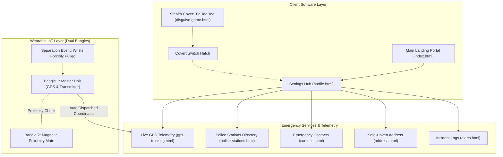

# Suraksha360 — Wearable Women's Safety IoT System & Emergency Portal

[](#technology-stack)
[](#system-architecture)
[](#core-features)
[](#stealth-disguise-mode)
[](LICENSE)

> **Suraksha360** is an IoT-enabled women's safety ecosystem designed around a discreet wearable device disguised as dual rubber bangles. Integrated with separation/proximity sensors, real-time GPS telemetry, and an emergency response web portal, the system automatically triggers alerts and provides rapid access to emergency services when the user is in danger.

---

## 📖 Table of Contents
- [Problem Statement &amp; Motivation](#problem-statement--motivation)
- [System Architecture](#system-architecture)
- [Core Features](#core-features)
- [Technology Stack](#technology-stack)
- [Project Directory Structure](#project-directory-structure)
- [Getting Started &amp; Running Locally](#getting-started--running-locally)
- [Testing &amp; Quality Assurance](#testing--quality-assurance)
- [Hardware &amp; IoT Concept Details](#hardware--iot-concept-details)
- [Known Limitations &amp; Future Scope](#known-limitations--future-scope)
- [Development Team](#development-team)
- [Repository](#repository)

---

## 🎯 Problem Statement &amp; Motivation

Women frequently face vulnerable situations in public, isolated, or commuting environments. Existing safety solutions typically suffer from critical design flaws:
1. **Overt Form Factors**: Physical panic buttons, smartwatches, or bulky alarms alert the assailant immediately, leading to confiscation.
2. **High Friction in Crisis**: Smartphone safety apps require unlocking the device, opening an app, and tapping an SOS button—actions that are physically impossible during sudden physical assault or struggle.
3. **No Disguise Protection**: If an aggressor inspects the victim's phone, conventional safety apps reveal that police or family are being alerted.

**The Suraksha360 Solution**:
- Disguised as traditional, ubiquitous rubber bangles.
- Zero-friction separation detection: when wrists are forcibly pulled apart in a struggle, the circuit breaks automatically.
- Conceals the digital safety interface behind an innocuous Tic Tac Toe game.
- Provides immediate one-touch routing to verified local police stations and family contacts.

---

## 🏗️ System Architecture



---

## ✨ Core Features

### 1. 🧲 Distance Separation Detection (Wearable IoT Concept)
Dual rubber bangles equipped with embedded proximity/magnetic sensors detect when hands are forcibly separated. The moment the threshold distance is exceeded, emergency alerts are dispatched automatically.

### 2. 📍 Real-Time GPS Telemetry Tracking (`gps-tracking.html`)
- Utilizes the W3C Geolocation API (`navigator.geolocation.watchPosition`) in continuous high-accuracy mode (`enableHighAccuracy: true`).
- Tracks and displays live latitude, longitude, speed, heading, and altitude.
- Generates a direct Google Maps navigation pin for emergency responder routing.

### 3. 🎮 Stealth Disguise Mode (`disguise-game.html`)
- Conceals the safety application behind a fully playable **Tic Tac Toe** game (`game.js` and `game.css`).
- Built-in stealth switch allows the user to discreetly access the safety dashboard without alerting nearby persons.

### 4. 🚓 Emergency Police Stations Directory (`police-stations.html`)
- Curated directory of 14 verified police stations in Visakhapatnam, Andhra Pradesh.
- Includes dedicated emergency stations: **Women Police Station (Suryabagh)** and **Disha Mahila Police Station (Yendada)**.
- Direct one-click calling (`tel:`) and Google Maps directions for every station.

### 5. 📞 Emergency Contacts Hotline (`contacts.html`)
- Pre-configured with essential emergency lines (Mom, Bestie, Police).
- Dynamic addition and deletion of trusted contacts.
- Persistent client-side storage across sessions via `localStorage`.

### 6. 🏠 Safe-Haven Address Manager (`address.html`)
- Maintains the user's primary residence / safe-haven location for emergency dispatch reference.
- In-place dynamic updates with client-side persistence.

### 7. 🔔 Timestamped Alert Logs &amp; Preferences (`alerts.html`)
- Detailed incident logs with event timestamps and trigger causes.
- Toggle switches for audible siren alarms, SMS notification dispatch, and auto-location streaming.

---

## 🛠️ Technology Stack

| Component | Technologies Used | Description |
|---|---|---|
| **Frontend Core** | HTML5, CSS3, Modern JavaScript (ES6+) | Lightweight, dependency-free responsive web client. |
| **Geolocation** | W3C Geolocation API | Continuous satellite tracking via `watchPosition`. |
| **Local Storage** | Web Storage API (`localStorage`) | Persistent client-side storage for contacts, addresses, and settings. |
| **Styling &amp; Assets** | Custom CSS3, Responsive Flexbox &amp; CSS Grid, SVG | Custom design system with soft gradients and tailored SVG icons. |
| **Disguise Engine** | Vanilla JavaScript DOM Manipulation | Turn-based Tic Tac Toe game logic with safe audio fallbacks. |
| **Data Layer** | JSON (`data/police_stations.json`) | Structured database of Visakhapatnam emergency stations. |
| **Testing** | Python 3 `unittest` | Automated structural, asset, hyperlink, and schema validation. |

---

## 📂 Project Directory Structure

```
Suraksha360/
├── frontend/                     # Client-Side Application
│   ├── assets/                   # Static assets & iconography
│   │   ├── icons/                # SVG UI icons (shield, bell, phone, police, etc.)
│   │   └── images/               # Logo, bangles concept diagram, neutral team avatars
│   ├── css/                      # Modular stylesheets
│   │   ├── main.css              # Main landing page styles
│   │   ├── dashboard.css         # Settings hub, profile, contacts, address & police styles
│   │   ├── auth.css              # Authentication form styling (signin/signup)
│   │   └── game.css              # Stealth Tic Tac Toe disguise styling
│   ├── js/                       # Client-side JavaScript
│   │   ├── app.js                # Core interactive logic (contacts, forms, alerts)
│   │   ├── gps.js                # High-accuracy Geolocation telemetry module
│   │   └── game.js               # Disguise game engine with safe audio error handling
│   ├── index.html                # Primary Suraksha360 landing page
│   ├── profile.html              # Settings Hub & Profile dashboard
│   ├── registered-info.html      # Emergency profile registration form
│   ├── alerts.html               # Incident logs & notification preferences
│   ├── contacts.html             # Emergency contacts hotline manager
│   ├── address.html              # Safe-haven address manager
│   ├── police-stations.html      # Visakhapatnam police stations directory
│   ├── gps-tracking.html         # Live real-time GPS telemetry tracker
│   ├── signin.html               # Sign In portal
│   ├── signup.html               # Sign Up portal
│   ├── disguise-game.html        # Casual Tic Tac Toe disguise game
│   └── logout.html               # Logout confirmation screen
│
├── data/                         # Project Datasets
│   └── police_stations.json      # Structured dataset of 14 Visakhapatnam police stations
│
├── docs/                         # Comprehensive Technical Documentation
│   ├── ARCHITECTURE.md           # IoT hardware & Web Application system architecture
│   ├── WORKFLOW.md               # Incident trigger & alert escalation workflow
│   └── API_DOCUMENTATION.md      # Geolocation & data schema specifications
│
├── tests/                        # Automated Validation Test Suite
│   └── test_pages.py             # Unit tests for links, DOM integrity, assets & JSON data
│
├── .gitignore                    # Git ignore file for web & environment files
├── .env.example                  # Environment configuration template
├── package.json                  # NPM project metadata & runner scripts
├── index.html                    # Root entrypoint redirecting to frontend/
└── README.md                     # Project documentation
```

---

## 🚀 Getting Started &amp; Running Locally

### Prerequisites
- Any modern web browser (Google Chrome, Mozilla Firefox, Microsoft Edge, Safari).
- *(Optional)* Node.js (v16+) or Python (v3.8+) to run a local development server.

### Option 1: Direct Browser Launch (Simplest)
Double-click `index.html` at the project root or open `frontend/index.html` directly in your browser.

### Option 2: Local HTTP Server with Node.js
```bash
# Clone the repository
git clone https://github.com/Divyasri866/Suraksha360.git
cd Suraksha360

# Serve with any static server (e.g. npx serve)
npx serve frontend
```

### Option 3: Local HTTP Server with Python
```bash
cd Suraksha360/frontend
python -m http.server 3000
```
Then visit `http://localhost:3000` in your browser.

---

## 🧪 Testing &amp; Quality Assurance

The repository includes an automated validation suite that verifies page links, stylesheet and script references, dataset integrity, and DOM structure.

```bash
# Run the automated test suite
python tests/test_pages.py
```

### Test Coverage:
- **`test_root_files_exist`**: Confirms all root configuration and documentation files are present.
- **`test_frontend_pages_exist`**: Validates all 12 frontend HTML pages exist.
- **`test_stylesheets_exist`**: Validates `main.css`, `dashboard.css`, `auth.css`, and `game.css`.
- **`test_scripts_exist`**: Confirms all JavaScript modules exist and resolve.
- **`test_documentation_exists`**: Verifies architecture, workflow, and API documentation files.
- **`test_police_stations_json`**: Validates the JSON schema and phone numbers for all 14 police stations.
- **`test_internal_references`**: Crawls every `<a href>`, `<link href>`, and `` across all HTML files to guarantee zero broken links.

---

## ⚠️ Known Limitations &amp; Future Scope

### Current Limitations:
1. **Browser Permission Dependency**: Real-time GPS tracking requires explicit user approval via the browser's Geolocation prompt. If the user denies permission, coordinates cannot be gathered.
2. **Local Storage Scope**: Emergency contacts and safe-haven addresses are saved in the client's `localStorage`. Clearing browser data resets these settings to defaults.
3. **Hardware Simulation**: The hardware separation trigger is currently conceptualized and demonstrated through client-side workflows; physical micro-controller hardware (ESP32/Arduino) requires serial or cellular bridge integration.

### Future Improvements:
- **Web Bluetooth / BLE Integration**: Connect the web dashboard directly to an ESP32 microcontroller embedded inside the bangles via Web Bluetooth API.
- **Automated SMS Gateway**: Connect the SOS trigger to a live SMS service (Twilio / Fast2SMS) using the credentials defined in `.env.example`.
- **Background PWA Service Worker**: Convert the frontend into a Progressive Web App (PWA) with background sync capabilities when offline.

---

## 👥 Development Team

Developed as part of the DT&amp;I Women Safety Initiative at **Idea-Lab, Vignan Institute of Information Technology (VIIT)**, Duvvada, Visakhapatnam:

- **A. Divya Sri** — Project Developer (`atmakuridivyasri@gmail.com`)
- **G.G.D. Gayatri** — Team Member (`gayatrivarma7277@gmail.com`)
- **A. Mouli Priya** — Team Member (`moulipriya23@gmail.com`)
- **A. JnanaSri** — Team Member (`jnanasriadapa@gmail.com`)

---

## 🔗 Repository
- **GitHub Repository**: [https://github.com/Divyasri866/Suraksha360](https://github.com/Divyasri866/Suraksha360)
