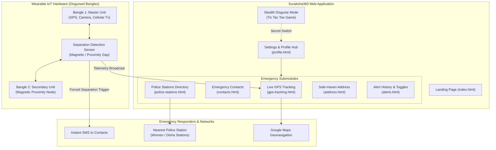

# Suraksha360 — System Architecture

**Suraksha360** is an IoT-enabled women's safety ecosystem designed around a discreet wearable device disguised as ordinary rubber bangles paired with an interactive emergency web dashboard.

---

## 1. High-Level Architecture

---

## 2. Hardware Subsystem Specifications

### A. Form Factor & Camouflage
- **Form Factor**: Traditional rubber/silicone bangles worn on the wrists.
- **Camouflage Advantage**: Unlike overt panic buttons, smartwatches, or pendants that an assailant might immediately notice or confiscate, standard rubber bangles are ubiquitous and unobtrusive.

### B. Sensor Separation Detection
- **Primary Mechanism**: Paired magnetic Reed sensors / Hall effect sensors embedded in the bangles.
- **Trigger Condition**: When wrists are forcibly separated or a bangle is pulled away beyond the calibrated safe threshold distance, the circuit breaks.
- **Zero-Friction Trigger**: Does not require the user to actively unlock a phone, open an app, or press an SOS button while under physical assault.

### C. On-Board Modules (Master Bangle)
1. **Micro GPS Receiver**: Acquires real-time latitude, longitude, velocity, altitude, and heading.
2. **Cellular GSM/GPRS Transmitter**: Transmits SOS packets and coordinates to pre-configured numbers and emergency endpoints.
3. **Micro Camera (Optional Spec)**: Captures snapshot frames during a separation event to record visual evidence.

---

## 3. Software Subsystem Specifications

### A. Client-Side Web Architecture
- **Pure Web Stack**: HTML5, CSS3, ES6+ JavaScript.
- **No Heavy Framework Overhead**: Rapid page loads, zero build steps required, and accessible from any smartphone browser.
- **W3C Geolocation API**: Continuous satellite monitoring using `navigator.geolocation.watchPosition` with high accuracy mode enabled.

### B. Stealth Disguise Architecture
- **Cover Screen (`disguise-game.html`)**: Interactive Tic Tac Toe casual game.
- **Covert Exit Hatch**: Discreetly integrated switch allowing the user to seamlessly jump back to the safety hub without raising suspicion.

### C. Directory & Safe-Haven Hub
- **Police Directory (`police-stations.html`)**: 14 verified stations in Visakhapatnam, featuring direct one-click `tel:` dialing and Google Maps coordinates.
- **Contacts Hotline (`contacts.html`)**: Dynamic DOM management with local storage persistence for trusted family and friends.
