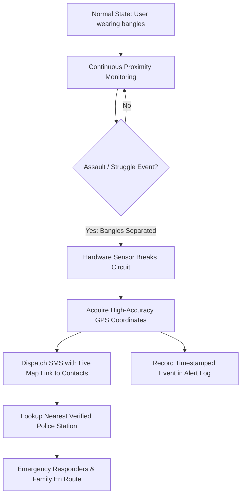

# Suraksha360 — Incident Escalation & Application Workflow

This document outlines the step-by-step lifecycle of emergency incident escalation and normal user workflows within the Suraksha360 ecosystem.

---

## 1. Emergency Escalation Workflow

### Stage 1: Continuous Proximity Monitoring
- Dual bangles maintain paired magnetic connection.
- Power consumption remains in ultra-low quiescent state.

### Stage 2: Separation Detection
- Under duress, struggle, or forcible wrist pulling, the distance between the bangles exceeds the safe threshold.
- The separation circuit triggers an interrupt on the onboard controller.

### Stage 3: Instant Telemetry Broadcast
- Master unit powers up the GPS module to lock high-precision latitude and longitude coordinates.
- Timestamp, coordinates, and speed are formatted into an emergency SOS message.

### Stage 4: Alert Dispatch
- Automated SMS broadcast sent to designated emergency contacts (e.g., Mom, Bestie, Helpline).
- Direct call routing initialized to nearest station or National Emergency (112 / 1091).

---

## 2. Web Portal User Workflows

### Workflow A: Initial Device Setup & Registration
1. User opens `index.html` on smartphone browser.
2. Navigates to **Settings Hub** (`profile.html`) -> **Registered User Profile** (`registered-info.html`).
3. Inputs legal name, personal mobile number, residential safe-haven address, and two 10-digit emergency contact numbers.
4. Validation checks verify 10-digit phone format before saving.

### Workflow B: Managing Emergency Contacts
1. User opens **Family & Friends Contacts** (`contacts.html`).
2. Reviews pre-loaded contacts (Mom, Bestie, Police).
3. Adds new trusted numbers via form (`contactName`, `contactPhone`).
4. Contacts persist across sessions in browser storage with instant one-touch `tel:` dialing.

### Workflow C: Stealth Disguise Activation
1. When traveling in unsafe or suspicious environments, user opens **Stealth Disguise Mode** (`disguise-game.html`).
2. The screen displays a casual **Tic Tac Toe** game.
3. If intercepted or questioned, the phone simply appears to be running a harmless game.
4. Tapping the covert **Switch** button transitions immediately to the authenticated safety dashboard.

### Workflow D: Live Telemetry Inspection
1. User opens **Real-Time GPS Tracking** (`gps-tracking.html`).
2. Browser prompts for Geolocation permission.
3. Satellite tracking streams live latitude, longitude, speed, and heading.
4. A direct **View Location in Google Maps** button allows verifying the exact pin location.
